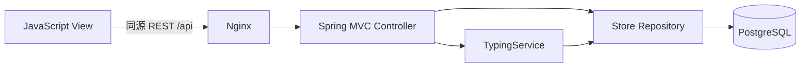

# 架構與設計

前後端獨立建置，無共用 source。Java record DTO 定義輸入，Bean Validation 驗證格式；資料表欄位以 snake_case JSON 輸出，請求與查詢使用 camelCase，契約記載於 API.md 與前端宣告型別。

Spring Security 提供 CSRF filter，身份驗證由 Controller 的集中 session helper 執行，每個受保護 API 必須使用 required()。會員文章另外檢查 members_only，所有紀錄查詢與更新都限定 session member_id。Cookie HttpOnly / SameSite=Lax；登入更新 session ID，登出使 session 失效。反向代理維持同源，未開放 wildcard CORS。

練習開始即保存文章快照。完成操作採 transaction + SELECT FOR UPDATE 鎖定；同筆重送會回傳既有結果，防止重複保存。各次按開始均為新的練習，開始請求沒有重送去重 key。分頁使用穩定 started_at/id 排序，單頁最多 20 筆。SQL 參數化，密碼雜湊不出現在 API。

## Production dependencies 理由

- Spring Boot Web：嵌入式 HTTP server 與 Spring MVC / JSON。
- Spring Security：CSRF、防護標頭、BCrypt。
- Validation：會員欄位與請求驗證。
- JDBC：參數化 SQL、資料存取與交易；不引入額外 ORM。
- PostgreSQL JDBC driver：正式資料庫連線。
- Flyway core / PostgreSQL 支援：可版本化 migration 與初始化文章。
- 前端沒有第三方 production 套件；Nginx 負責靜態服務、代理與驗證入口限流。
- H2、Spring Test、Security Test 僅測試使用。

## 版本參考

[Spring Boot 3.5 系统需求](https://docs.spring.io/spring-boot/3.5/system-requirements.html)列出 Java 17 最低需求。
[Spring Security CSRF 文件](https://docs.spring.io/spring-security/reference/features/exploits/csrf.html)說明 Session token 保護。
